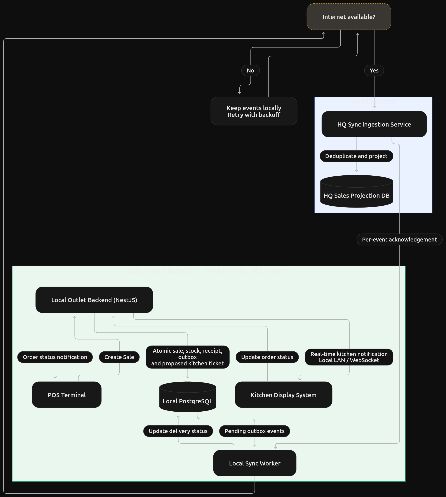
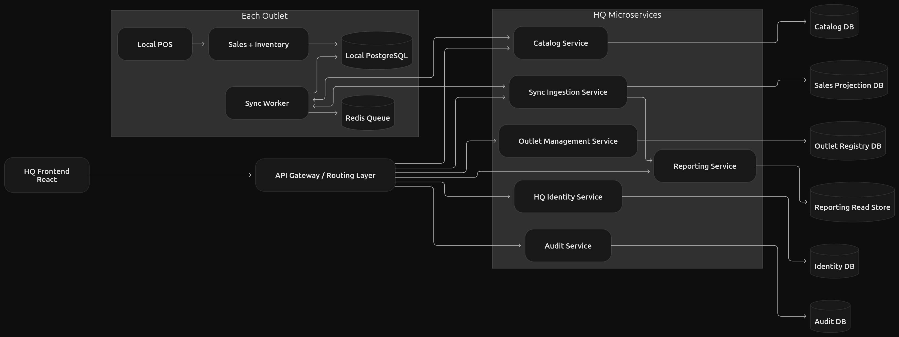

# fnb-platform — Multi-Outlet F&B Management Platform

A restaurant / F&B platform where **Headquarters (HQ)** owns the master menu, outlet
assignments and cross-outlet reporting, while every **outlet** runs its own
point-of-sale that keeps selling even when HQ is unreachable. The repo is a monorepo
of **four independently built and deployed apps** (specified in
[fnb_multi_outlet_prd.md](./fnb_multi_outlet_prd.md)):

| Application | Folder | Stack |
|---|---|---|
| HQ backend (API + worker) | `hq-backend/` | NestJS, TypeScript (ESM), PostgreSQL, Redis |
| Outlet backend (API + sync worker) | `outlet-backend/` | NestJS, TypeScript (ESM), PostgreSQL, Redis |
| HQ frontend (management console) | `hq-frontend/` | React 19, TanStack Start (SPA), Vite, Tailwind |
| Outlet frontend (POS terminal) | `outlet-frontend/` | React 19, TanStack Start (SPA), Vite, Tailwind |

All projects use **pnpm** (pinned via `packageManager` in each `package.json`).

## Table of contents

- [What it does, in two paragraphs](#what-it-does-in-two-paragraphs)
- [Quick start (Docker — minimum effort)](#quick-start-docker--minimum-effort)
  - [One-shot alternative](#one-shot-alternative)
  - [Pair the outlet terminal with HQ (UI flow, ~2 minutes)](#pair-the-outlet-terminal-with-hq-ui-flow-2-minutes)
  - [Log in and verify](#log-in-and-verify)
  - [Reset / teardown](#reset--teardown)
  - [Development without Docker (optional)](#development-without-docker-optional)
- [API endpoints](#api-endpoints)
  - [HQ endpoints](#hq-endpoints)
  - [Outlet endpoints](#outlet-endpoints)
- [Database schemas](#database-schemas)
  - [HQ schema (`fnb_hq`)](#hq-schema-fnb_hq)
  - [Outlet schema (`fnb_outlet_a` — one per site)](#outlet-schema-fnb_outlet_a--one-per-site)
- [Architecture](#architecture)
  - [HQ architecture — menu, assignments, reports, sync settings](#hq-architecture--menu-assignments-reports-sync-settings)
  - [Outlet architecture — menu sync, stock, sales, push to HQ, offline](#outlet-architecture--menu-sync-stock-sales-push-to-hq-offline)
- [Offline connectivity strategy — POS, KDS, and reconnect sync](#offline-connectivity-strategy--pos-kds-and-reconnect-sync)
  - [How offline terminals resync sales to HQ when the internet returns](#how-offline-terminals-resync-sales-to-hq-when-the-internet-returns)
  - [How POS and KDS communicate during offline mode (proposed extension)](#how-pos-and-kds-communicate-during-offline-mode-proposed-extension)
- [Conversion to microservices — evolution path](#conversion-to-microservices--evolution-path)
  - [Target architecture](#target-architecture)
  - [Service decomposition vs today's monolith](#service-decomposition-vs-todays-monolith)
  - [Guardrails the split must preserve](#guardrails-the-split-must-preserve)
  - [Suggested extraction order (strangler pattern)](#suggested-extraction-order-strangler-pattern)
- [Scaling strategy — 10 outlets · 100k sales → 10–100M sales](#scaling-strategy--10-outlets-100k-sales--10100m-sales)
  - [Growth path](#growth-path)
  - [Outlets: one server per site, unchanged at every stage](#outlets-one-server-per-site-unchanged-at-every-stage)
  - [HQ database: vertical → pooling → replica → partitions → shards](#hq-database-vertical--pooling--replica--partitions--shards)
  - [HQ servers: vertical, then a load balancer — gradually](#hq-servers-vertical-then-a-load-balancer--gradually)
  - [Cache strategy](#cache-strategy)
  - [Target topology](#target-topology)

## What it does, in two paragraphs

**How HQ manages items.** HQ staff sign in to the HQ console and manage master menu
categories and items (name, SKU, description, default price) and provision outlets.
For each outlet they assign menu items — optionally with a per-outlet price override —
and issue the machine sync credentials the outlet terminal needs. Every menu or
assignment edit bumps a per-outlet catalog **revision** and appends a change record
(`UPSERT`/`REMOVE`) **in the same database transaction**; outlets pull those changes.
HQ also receives each outlet's sales as immutable read-only projections and serves
reports from them, always disclosing sync lag (`dataAsOf`, `isProvisional`).

**How an outlet sells and manages stock.** Each outlet is a self-contained stack: its
own backend, PostgreSQL database, Redis, POS frontend and sync worker. Staff sign in
locally, see the menu synced from HQ, stock items on the Inventory page (audited
restock / write-off / recount), and ring up sales. A sale is **one local PostgreSQL
transaction**: prices and totals are resolved server-side from the local catalog
snapshot (the client sends only item IDs + quantities), stock is decremented with
row locks, a gapless receipt number (`A-000001`, `A-000002`, …) is allocated from a
per-outlet counter, and exactly one `sale.completed` event is appended to a
transactional outbox. The sync worker pushes outbox events to HQ and pulls menu
changes in the background — **a sale never waits on HQ**, so selling continues
during HQ outages and the backlog drains automatically once HQ returns.

Conventions used everywhere: money is integer minor units as decimal strings
(`"1200"`, never a JS number), timestamps are UTC ISO-8601, IDs are UUIDs, and every
HTTP response uses the `ApiSuccess`/`ApiError` envelope with `X-Request-Id`.

## Quick start (Docker — minimum effort)

Prerequisite: **git** and **Docker Engine with Compose v2** (`docker compose
version`). Node/pnpm/Postgres are not needed — every command runs inside the built
images.

```bash
# 1. Clone and configure (the root .env is the only required file —
#    its pre-filled defaults boot the whole stack as-is)
git clone <repo-url> && cd fnb-platform
cp .env.example .env

# 2. Build and start everything (migrations run automatically
#    via the hq-migrate / outlet-a-migrate jobs before the APIs start)
docker compose up --build -d

# 3. Seed HQ (idempotent): super admin + demo outlets A/B/C + demo items
docker compose run --rm hq-api node dist/database/seed.js
```

### One-shot alternative

`./setup_env` does steps 1–3 in one go: copies every `.env.example` to `.env`
(existing files kept), builds the images, starts the stack, seeds HQ, and prints the
pairing walkthrough below.

### Pair the outlet terminal with HQ (UI flow, ~2 minutes)

Outlet terminals ship **unprovisioned** on purpose — identity and the HQ machine key
are entered through the POS setup wizard, not config files:

1. **Create the outlet in HQ** — open the **HQ console: http://localhost:8080**, sign
   in with the seeded admin (`admin@fnb.local` / `Admin123!`), go to *Outlets* →
   create an outlet (or pick a seeded demo outlet A/B/C) and copy its
   **Outlet ID + code** from the pairing panel.
2. **Provision the terminal** — open the **outlet console: http://localhost:8081/setup**
   and in wizard **step 1** paste the Outlet ID + code, plus the first admin account
   (email + password) for that register. This commits once, then seals permanently.
3. **Issue the sync key in HQ** — in the HQ console open the outlet → *Settings* →
   *Outlet sync keys* → *Issue new key*, and copy the one-time **Key ID + Key secret**.
4. **Pair** — back in the wizard **step 2**, paste the key pair (a combined
   `keyId.secret` paste is auto-split) and hit **Test & pair**. The key is validated
   live against HQ and stored in the outlet's own database — the sync worker picks it
   up without a restart. (HQ URL is pre-filled for the Compose network.)

### Log in and verify

| URL | What |
|---|---|
| http://localhost:8080 | **HQ console** — `admin@fnb.local` / `Admin123!` |
| http://localhost:8081 | **Outlet POS** — the admin account you created in the wizard |
| http://localhost:4000/api/v1/docs | HQ Swagger UI (local cluster only) |
| http://localhost:5000/api/v1/docs | Outlet Swagger UI (local cluster only) |

Quickest end-to-end check: in HQ assign items to your outlet (*Outlets* → open the
outlet → tick items → *Assign*, optional per-item price), wait one menu pull (~30s),
stock the items on the POS *Inventory* page, ring up a sale — then watch it land in
HQ's dashboard/reports within a few sync cycles. `docker compose logs -f
outlet-a-worker` shows menu pulls and event pushes; the POS *Sync* page and
`GET /api/v1/sync/status` show the local revision and outbox backlog.

### Reset / teardown

```bash
docker compose down        # stop the stack, keep data volumes
docker compose down -v     # also wipe both databases and queues (irreversible)
```

### Development without Docker (optional)

Datastores still come from Compose: `docker compose up -d hq-db hq-redis outlet-a-db outlet-a-redis`.
Then each app is independent (pnpm; per-app `.env.example` files target the
Compose-published stores):

```bash
cd hq-backend      && pnpm install && pnpm migration:run && pnpm seed && pnpm start:dev   # API :3000
cd outlet-backend  && pnpm install && pnpm migration:run && pnpm seed && pnpm start:dev   # API :3000
# outlet sync worker:  pnpm start:worker   (or pnpm build && node dist/worker-main.js)

cd hq-frontend     && pnpm install && pnpm dev    # Vite :3000 — proxies /api → localhost:4000
cd outlet-frontend && pnpm install && pnpm dev    # Vite :3000 — proxies /api → localhost:5000
```

(Both frontend dev servers pin port 3000 — run them one at a time or override the
port. The outlet `pnpm seed` is a UI-less dev path with fixed demo accounts
`manager|cashier|clerk@outlet-a.local`; the Docker flow uses the setup wizard instead.)

---

## API endpoints

All paths are relative to the versioned base: HQ `http://localhost:4000/api/v1`,
Outlet `http://localhost:5000/api/v1`. Human routes require a bearer JWT (login →
access token; refresh token rotates in an HttpOnly cookie) and an RBAC permission;
the machine sync routes require the outlet key header
(`Authorization: OutletKey <keyId>.<secret>`).

### HQ endpoints

| Method | Endpoint | What it does |
|---|---|---|
| GET | `/health` | Liveness/readiness probe (database + Redis) |
| POST | `/auth/login` | Sign in (rate limited); sets the refresh cookie |
| POST | `/auth/refresh` | Rotate the refresh cookie, mint a new access token |
| POST | `/auth/logout` | Revoke the current refresh session family |
| GET | `/categories` | List menu categories |
| POST | `/categories` | Create a category |
| GET | `/categories/:id` | Read one category |
| PATCH | `/categories/:id` | Rename / reorder / archive a category |
| GET | `/menu-items` | List master menu items (keyset pagination) |
| POST | `/menu-items` | Create a master item |
| GET | `/menu-items/:id` | Read one master item |
| PATCH | `/menu-items/:id` | Update and/or archive a master item (fans out catalog changes) |
| GET | `/outlets` | List outlets with their current catalog revision |
| POST | `/outlets` | Provision an outlet (creates its revision-0 catalog row) |
| PATCH | `/outlets/:id` | Rename or suspend/reactivate an outlet |
| GET | `/outlets/:id/sync-status` | Replication status HQ knows about that outlet (watermarks, backlog) |
| POST | `/outlets/:outletId/menu` | Bulk-assign up to 200 items to an outlet atomically (one transaction) |
| PUT | `/outlets/:outletId/menu/:itemId` | Assign/activate one item, optionally with a price override |
| DELETE | `/outlets/:outletId/menu/:itemId` | Unassign an item (emits a REMOVE revision) |
| GET | `/outlets/:outletId/menu` | Assignment matrix rows for one outlet |
| POST | `/outlets/:outletId/api-keys` | Issue an outlet sync key (secret shown once) |
| GET | `/outlets/:outletId/api-keys` | List the outlet's keys (no secret material) |
| POST | `/outlets/:outletId/api-keys/:keyId/rotate` | Rotate a key (predecessor stays valid for a grace window) |
| DELETE | `/outlets/:outletId/api-keys/:keyId` | Revoke a key immediately |
| GET | `/users` | List HQ users |
| POST | `/users` | Create an HQ user with roles |
| PATCH | `/users/:id` | Update status and/or replace roles |
| GET | `/roles` | List roles with their permission sets |
| GET | `/reports/revenue-by-outlet` | Completed revenue per outlet for a UTC window |
| GET | `/reports/outlets/:id/top-items` | Top-selling items for one outlet |
| GET | `/audit/logs` | Immutable audit trail (newest first, filterable) |

Machine sync routes (outlet key, not user JWT) — these are what the outlet worker calls:

| Method | Endpoint | What it does |
|---|---|---|
| GET | `/sync/v1/menu/changes` | Revisioned catalog deltas for the calling outlet (ascending) |
| GET | `/sync/v1/menu/snapshot` | Full consistent catalog snapshot (bootstrap / gap recovery) |
| POST | `/sync/v1/events/batch` | Push a batch of sale events; per-event acks on one response |
| GET | `/sync/v1/checkpoint` | Highest contiguous accepted sequence + missing ranges |
| POST | `/sync/v1/heartbeat` | Outlet reports its backlog and applied menu revision |

### Outlet endpoints

| Method | Endpoint | What it does |
|---|---|---|
| GET | `/health` | Liveness/readiness probe (database + Redis) |
| POST | `/auth/login` | Local staff sign in (rate limited); sets the refresh cookie |
| POST | `/auth/refresh` | Rotate the refresh cookie, mint a new access token |
| POST | `/auth/logout` | Revoke the current refresh session family |
| GET | `/setup/status` | Terminal provisioning state (drives the setup wizard) |
| POST | `/setup/identity` | Wizard step 1: save HQ-issued Outlet ID + code, create first admin (seals after use) |
| POST | `/setup/hq-connection` | Wizard step 2: validate the HQ key live and pair this terminal (seals after use) |
| GET | `/users` | List local outlet users |
| POST | `/users` | Create a local outlet user with roles |
| PATCH | `/users/:id` | Update status and/or replace roles |
| GET | `/roles` | List local roles with their permission sets |
| GET | `/menu` | Active local menu with effective prices and stock (`catalogRevision` in meta) |
| GET | `/inventory` | Every catalog item with its stock balance |
| POST | `/inventory/adjustments` | Audited stock adjustment (RESTOCK / WRITE_OFF / RECOUNT) |
| POST | `/sales` | Create an atomic multi-item sale (requires `Idempotency-Key` header) |
| GET | `/sales` | Local sale history (keyset pagination, optional date range) |
| GET | `/sales/:id` | Receipt detail with immutable line snapshots + sync status |
| GET | `/sync/status` | Local menu-sync checkpoint and outbox backlog |
| PUT | `/sync/hq-connection` | Rotate the stored HQ machine key (validated against HQ first) |
| POST | `/sync/grace-override` | Extend the offline grace window (privileged, audited) |
| POST | `/sync/outbox/:eventId/replay` | Re-arm a quarantined outbox event after operator review |

---

## Database schemas

Both databases are PostgreSQL, managed exclusively by TypeORM migrations
(`synchronize` is off). Money columns are `bigint` minor units; prices in this table
marked `_minor` follow the decimal-string convention.

### HQ schema (`fnb_hq`)

| Table | What it stores |
|---|---|
| `companies` | Single tenant root; scopes every HQ row and defines the base currency |
| `outlets` | Registered outlets: code, name, timezone, ACTIVE/SUSPENDED status |
| `hq_users` | HQ staff accounts (email, bcrypt password hash, ACTIVE/DISABLED) |
| `hq_roles` / `hq_permissions` | Role bundles (e.g. HQ_SUPER_ADMIN) and the permission catalog (dot-case codes) |
| `hq_user_roles` / `hq_role_permissions` | User↔role and role↔permission mappings |
| `hq_refresh_sessions` | One row per issued refresh JWT; enables rotation and family revocation on reuse |
| `menu_categories` | Master menu categories (name, sort order); archived, never deleted |
| `master_menu_items` | Master catalog items: SKU, name, default price, currency; versioned, archived instead of deleted |
| `outlet_menu_assignments` | Which items are sold at which outlet, with optional `price_override_minor`; effective price = override ?? default |
| `outlet_catalog_revisions` | One locked counter row per outlet holding its current catalog revision |
| `outlet_catalog_changes` | Append-only per-outlet change log (`UPSERT`/`REMOVE` + full item payload) that outlets pull |
| `outlet_api_keys` | Machine sync credentials: key ID, peppered HMAC secret hash, scopes, ACTIVE/REVOKED |
| `sync_inbox_events` | Dedupe ledger of accepted outlet events (unique per outlet+event and outlet+sequence) |
| `hq_sales` / `hq_sale_items` | Immutable read-only projections of synced sales with as-sold name/price snapshots — the only source reports read |
| `sync_outlet_checkpoints` | Per-outlet sync watermark: highest contiguous sequence, last heartbeat, reported backlog, seen menu revision |
| `audit_logs` | Immutable operations/security audit trail (actor, action, entity, metadata) |

### Outlet schema (`fnb_outlet_a` — one per site)

| Table | What it stores |
|---|---|
| `outlet_identity` | Singleton terminal identity: HQ-issued Outlet ID + code, timezone, currency |
| `hq_connection` | Singleton pairing with HQ: base URL + machine key; the only place the secret lives |
| `outlet_users` | Local staff accounts (email, bcrypt hash, ACTIVE/DISABLED) |
| `outlet_roles` / `outlet_permissions` | Local roles (manager / cashier / clerk) and permission codes |
| `outlet_user_roles` / `outlet_role_permissions` | User↔role and role↔permission mappings |
| `outlet_refresh_sessions` | One row per issued refresh JWT (rotation + family revocation) |
| `outlet_audit_logs` | Local audit of privileged actions (grace overrides, replay) |
| `catalog_items` | Local read-model of the HQ-assigned menu: names, SKUs, effective prices, active flag — written only by sync |
| `menu_sync_state` | Singleton menu-sync checkpoint: last applied HQ revision, last sync time, grace override expiry |
| `inventory_balances` | On-hand stock per assigned item (never negative, versioned for row locking) |
| `stock_movements` | Append-only stock ledger: signed delta + reason (SALE / RESTOCK / WRITE_OFF / RECOUNT), actor, request ID |
| `sales` / `sale_items` | Completed sale header (gapless receipt `A-000001`, total, catalog revision) and immutable line snapshots |
| `sale_idempotency_keys` | Per-attempt idempotency records: request hash → stored response, so safe retries replay the same receipt |
| `receipt_counters` | Singleton per-outlet receipt allocator (locked inside the sale transaction) |
| `outbox_events` | Transactional outbox of `sale.completed` events: payload + SHA-256 hash, sequence number, PENDING/RETRY/DELIVERED/QUARANTINED |
| `outbox_counters` | Singleton allocator for the contiguous per-outlet event sequence numbers |
| `sync_attempt_logs` | Append-only delivery ledger per outbox event (HTTP status, duration, error code) |

---

## Architecture

```
┌──────────────────────────── HQ (central, one deployment) ─────────────────────────┐
│                                                                                   │
│   HQ Console (browser) ──▶ HQ API (NestJS, /api/v1) ──▶ HQ PostgreSQL (fnb_hq)    │
│                                 │       └──▶ HQ Redis (queues + health)           │
│                                 └──▶ HQ Worker (audit-log retention, hourly)      │
└────────────────────────────────────────┬──────────────────────────────────────────┘
                                         │  HTTPS, outlet-initiated ONLY:
                                         │    pull menu: GET  /sync/v1/menu/changes|snapshot
                                         │    push sales: POST /sync/v1/events/batch
                                         │    GET checkpoint · POST heartbeat
                                         │  (HQ never connects to any outlet)
┌──────────────────────── OUTLET (own stack, repeatable per site) ──────────────────┐
│                                                                                   │
│   POS terminal (browser) ──▶ Outlet API (NestJS, /api/v1) ──▶ Outlet PostgreSQL   │
│                                   │       └──▶ Outlet Redis (worker queues only)  │
│                                   └──▶ Outlet Sync Worker (BullMQ) ──▶ HTTPS ──▶ HQ│
└───────────────────────────────────────────────────────────────────────────────────┘
```

The two environments are fully isolated (separate networks, databases, Redis, JWT
secrets). The only bridge is the outlet worker's outbound HTTPS to the HQ sync API,
authenticated with the machine key stored in the outlet's `hq_connection` table.
The outlet API process deliberately holds **zero** Redis/queue connections so the
sale path cannot be disturbed by queue or HQ problems.

### HQ architecture — menu, assignments, reports, sync settings

```
┌───────────────────────────────────── HQ ──────────────────────────────────────┐
│                                                                               │
│  HQ Console pages: dashboard · menu · outlets · users · reports · audit       │
│        │  (same-origin /api proxy)                                            │
│        ▼                                                                      │
│  HQ API: JWT guard + RBAC (menu.write, outlets.write, assignments.write,      │
│          keys.manage, reports.read, audit.read …)                             │
│        │                                                                      │
│        ▼                                                                      │
│  ┌───────────────────────────── HQ PostgreSQL ─────────────────────────────┐  │
│  │  master_menu_items ──▶ outlet_menu_assignments (+ price override)       │  │
│  │        │                          │                                     │  │
│  │        └───── ONE transaction ────┴─▶ outlet_catalog_revisions (rev + 1)│  │
│  │                                          └─▶ outlet_catalog_changes     │  │
│  │                                              (UPSERT/REMOVE payload)    │  │
│  │  outlet_api_keys (peppered HMAC)      sync_inbox_events (dedupe)        │  │
│  │  hq_sales + hq_sale_items (projections) sync_outlet_checkpoints         │  │
│  │  audit_logs                                                             │  │
│  └─────────────────────────────────────────────────────────────────────────┘  │
│                                                                               │
│  /sync/v1/* (outlet key): menu pull · events batch · checkpoint · heartbeat   │
└───────────────────────────────────────────────────────────────────────────────┘
```

- **Menu items.** A create/update/archive of a category or item writes
  `master_menu_items` and, in the *same* transaction, bumps every assigned outlet's
  `outlet_catalog_revisions.current_revision` and appends an `outlet_catalog_changes`
  row carrying the full item payload (`UPSERT` or `REMOVE`). A crash can therefore
  never leave an outlet's revision and change log inconsistent.
- **Outlet assignment.** Provisioning an outlet creates its revision-0 row; assigning
  items (single or bulk, up to 200, all-or-nothing) writes
  `outlet_menu_assignments` — effective price = `price_override_minor` ?? the master
  default — and emits one revision per changed item. Unassignment emits `REMOVE`.
- **Reports.** Reporting is a read projection over `hq_sales` / `hq_sale_items`
  computed on request (no report tables). Every response carries `dataAsOf`
  (max ingestion watermark) and `isProvisional` while any outlet has a backlog or has
  never reported — stale data is never mistaken for zero sales.
- **Sync settings.** Each outlet's sync credential is an `outlet_api_keys` row
  (256-bit secret shown once, stored as a peppered HMAC). HQ can list, rotate (with a
  grace window where the predecessor stays valid), and revoke keys; per-outlet
  health/progress is visible via `/outlets/:id/sync-status`, fed by heartbeats and
  checkpoints. Ingest is transactional: each pushed event is deduped in
  `sync_inbox_events`, projected into `hq_sales`, and acked
  (`ACCEPTED` / `DUPLICATE` / `RETRYABLE_ERROR` / `REJECTED_PERMANENT`) — so replays
  are harmless and effects are exactly-once.

### Outlet architecture — menu sync, stock, sales, push to HQ, offline

```
┌──────────────────────────────────── OUTLET ───────────────────────────────────┐
│                                                                               │
│  POS pages: pos · inventory · sales · sync · users        setup wizard (/setup)│
│        │  (same-origin /api proxy)                                            │
│        ▼                                                                      │
│  Outlet API: JWT guard + local RBAC (sales.create, inventory.adjust,          │
│              sync.override …)                                                 │
│        │                                                                      │
│        ▼                                                                      │
│  ┌────────────────────────── Outlet PostgreSQL ────────────────────────────┐  │
│  │  catalog_items (HQ snapshot)     menu_sync_state (applied revision)     │  │
│  │  inventory_balances + stock_movements (ledger)                          │  │
│  │  sales + sale_items + receipt_counters + sale_idempotency_keys          │  │
│  │  outbox_events + outbox_counters + sync_attempt_logs                    │  │
│  │  hq_connection (base URL + machine key)                                 │  │
│  └─────────────────────────────────────────────────────────────────────────┘  │
│                                                                               │
│  Sync Worker (separate process; BullMQ queues in Redis)                       │
│    menu-pull (30s) · outbox sweep (5s) · delivery · reconcile (1h) ·          │
│    heartbeat (60s)                                                            │
└───────────────────────────────────────────────────────────────────────────────┘
```

**1. How the menu arrives from HQ (pull).** The worker pulls every
`MENU_PULL_INTERVAL_MS` (default 30s): `GET /sync/v1/menu/changes?since=last_applied_revision`
against the outlet's own revision, authenticated with the machine key from
`hq_connection`. All deltas are applied in **one transaction** — upsert/remove rows in
`catalog_items` and `menu_sync_state.last_applied_revision = N` — so a mid-apply
failure commits nothing and the checkpoint never advances past unapplied data. If the
change history has a gap (or the terminal is new), it falls back to
`GET /sync/v1/menu/snapshot` and rebuilds the whole local catalog. Until paired, the
worker idles and logs `awaiting_provisioning`; pairing happens once through the setup
wizard (identity + live-validated key → `hq_connection`), picked up without a restart.

**2. How stock is maintained.** Each assigned item has one `inventory_balances` row
(`quantity_on_hand`, CHECK ≥ 0, optimistic `version`) plus an append-only
`stock_movements` ledger. Sales decrement stock inside the sale transaction; clerks
adjust it through audited RESTOCK / WRITE_OFF / RECOUNT adjustments that record
reason, actor and request ID. New items arrive at 0 until first stocked. Row locks
(`FOR UPDATE`) and deterministic item-ID ordering — not application mutexes — are the
concurrency control, so concurrent sales serialize safely and a last-unit race is
won by exactly one buyer.

**3. How a sale happens (receipt included).** The POS sends
`POST /api/v1/sales` with an `Idempotency-Key` header and body items only
(`{ menuItemId, quantity }` — never prices, totals, or receipt numbers; the server
computes those):

```
ONE PostgreSQL transaction (deterministic lock order):
  1  lock the idempotency row        → same key+body replays the stored receipt
  2  offline-grace check             → last sync within OFFLINE_GRACE_HOURS (72h)
                                        else 503 SYNC_TEMPORARILY_UNAVAILABLE
  3  resolve prices from catalog_items (effective price incl. HQ override)
  4  lock inventory rows (sorted item IDs) → any INSUFFICIENT_STOCK ⇒ full rollback
  5  decrement balances + append stock_movements (reason = SALE)
  6  receipt_counters FOR UPDATE     → gapless per-outlet receipt A-000001, A-000002, …
  7  insert sales + sale_items       → immutable name/SKU/price snapshots
  8  outbox_counters + outbox_events → exactly one sale.completed event, sequence N
COMMIT → authoritative receipt response to the cashier
```

Later HQ price changes only affect future sales — receipts keep their time-of-sale
snapshot prices. Retries reuse the same idempotency key and replay the same receipt;
reusing a key with a *different* body is rejected (`IDEMPOTENCY_KEY_REUSED`).

**4. How sales reach HQ (push).** The worker sweeps the outbox every 5s, leases due
events (`FOR UPDATE SKIP LOCKED`) and delivers them in batches to
`POST HQ /sync/v1/events/batch`. HQ answers with per-event acks:
`ACCEPTED` → `DELIVERED`; `DUPLICATE` (already ingested) → `DELIVERED`;
`RETRYABLE_ERROR` → `RETRY` with capped exponential backoff;
`REJECTED_PERMANENT` → `QUARANTINED` for manager review
(`POST /sync/outbox/:eventId/replay`). An event is never marked delivered before HQ
acked it, and HQ's transactional inbox (`sync_inbox_events` unique constraints) makes
replays no-ops — at-least-once transport, exactly-once effects.

**5. Why selling continues when HQ is down.** The sale path is entirely local: the
POS talks only to the outlet API, the outlet API talks only to the outlet's own
PostgreSQL (zero Redis/queue connections, zero HQ calls), and receipts come from the
local counter, so numbering stays gapless with no HQ dependency. When HQ is
unreachable, committed sales simply accumulate as `PENDING` outbox rows (visible on
`GET /api/v1/sync/status` and the POS sync banner) while the worker retries with
backoff. Sales are allowed offline up to the grace window (`OFFLINE_GRACE_HOURS`,
default 72h); past it, new sales are blocked with
`503 SYNC_TEMPORARILY_UNAVAILABLE` until a successful sync — or until a manager uses
the audited emergency override (`POST /sync/grace-override`). The moment HQ returns,
the backlog drains automatically and HQ projects every sale exactly once; reports
show `dataAsOf` + `isProvisional: true` in the meantime, never silently stale zeros.

---

## Offline connectivity strategy — POS, KDS, and reconnect sync



One picture, two promises. Everything inside the green **Outlet** box — POS
terminal, local backend, local PostgreSQL, Kitchen Display System, sync worker —
runs on the restaurant's own local network and keeps working with no internet;
the only bridge to the blue **HQ** box is the sync worker's outbound HTTPS, gated
by the *Internet available?* decision.

### How offline terminals resync sales to HQ when the internet returns

Offline durability is the transactional outbox — a completed sale and its sync
record commit together, so there is nothing in memory (or in a queue a restart
would lose) that an outage can destroy:

1. **Sell locally, commit once.** During an outage the POS keeps calling the local
   outlet API; each sale commits its stock decrement, gapless receipt number and
   exactly one `sale.completed` event in a single PostgreSQL transaction (the
   numbered walkthrough in the outlet architecture section above).
2. **Accumulate as PENDING, don't block.** Committed sales pile up as pending
   outbox rows — visible on `GET /api/v1/sync/status` and the POS sync banner —
   while the worker retries with backoff. Selling stays open for the configurable
   offline grace window (`OFFLINE_GRACE_HOURS`, default 72 h); past it, new sales
   are refused with `503 SYNC_TEMPORARILY_UNAVAILABLE` until a sync succeeds or a
   manager applies the audited emergency override (`POST /sync/grace-override`).
3. **Drain in batches on reconnect.** When HQ becomes reachable again the worker
   leases due events (`FOR UPDATE SKIP LOCKED`) and pushes them in batches to
   `POST /sync/v1/events/batch` over HTTPS — automatic, no operator action and no
   manual replay step.
4. **Dedupe and project at HQ, ack per event.** HQ validates each event against
   the `sync_inbox_events` dedupe ledger before projecting it into `hq_sales`,
   then answers every event individually: `ACCEPTED` / `DUPLICATE` → the event is
   marked `DELIVERED` (replays are no-ops), `RETRYABLE_ERROR` → `RETRY` with
   capped exponential backoff, `REJECTED_PERMANENT` → `QUARANTINED` for manager
   review and replay.
5. **Never delivered without an ack.** Only an HQ acknowledgement advances an
   event's status, and the worker writes that delivery status back to the local
   database — outbox, sync status API and HQ checkpoints converge on the same
   truth. Reports meanwhile disclose `dataAsOf` / `isProvisional` so the backlog
   gap is never mistaken for zero sales.

Net effect: no completed sale is lost during an outage, none is counted twice at
HQ, and recovery is a background drain rather than a procedure.

### How POS and KDS communicate during offline mode (proposed extension)

Today the POS is the only in-store client; the strategy diagram shows the natural
next step — a **Kitchen Display System** on the same LAN, as one more client of
the local backend:

- **The local backend is the hub, never HQ.** The cashier creates sales via
  `POST /api/v1/sales`; KDS screens talk to the same outlet API. All POS ↔ KDS
  traffic stays on the local network and touches no HQ resource, so kitchen
  operations need no internet either.
- **Kitchen tickets are persisted with the sale.** The ticket would be written in
  the sale transaction itself (the diagram's "atomic sale, stock, receipt, outbox
  and proposed kitchen ticket"), so a reloaded or rebooted KDS screen recovers
  its open tickets from PostgreSQL instead of losing them.
- **Real-time over a LAN WebSocket, reconciled from the database.** The backend
  pushes new orders and status changes (Preparing → Ready → Served) to the KDS
  over a local WebSocket and mirrors order-status notifications back to the POS
  terminal. Because the state lives in the database, recovery is mechanical:
  automatic reconnection, an API-based reconciliation query on (re)load, a
  polling fallback where WebSockets are blocked, and idempotent status updates so
  a duplicate push can never corrupt an order.
- **Zero impact on the sync boundary.** KDS is a purely outlet-local concern; the
  outbox, checkpoints and HQ ingestion machinery need no change.

Combined, the strategy is: local transactional selling + persistent order/ticket
storage + LAN-based real-time displays + asynchronous exactly-once
synchronization to HQ — the restaurant keeps taking orders through an internet
outage and reconciles perfectly once it returns.

---

## Conversion to microservices — evolution path

The platform can gradually evolve into a microservices architecture by separating
the major business functionalities of the HQ backend into smaller, independently
deployable services.

Today the system consists of an HQ backend, HQ frontend, outlet backend and outlet
frontend. The HQ backend handles menu management, outlet management, authentication,
sales synchronization, reporting and auditing. Each outlet operates independently
with its own database and synchronization worker.

In the proposed microservices architecture, the HQ backend would be divided into the
following services:

1. **Catalog Service** — manages master menu items, categories, outlet-specific menu
   assignments, prices and catalog revisions.
2. **Outlet Management Service** — handles outlet registration, identity, activation
   and suspension.
3. **Authentication Service** — manages HQ user authentication, roles and access
   permissions.
4. **Synchronization and Sales Ingestion Service** — receives sales events from
   outlets, prevents duplicate processing and maintains synchronized sales records.
5. **Reporting Service** — generates revenue reports, sales summaries and business
   analytics from the synchronized sales data.
6. **Audit Service** — maintains immutable records of important administrative and
   security activities.

Each microservice would have clearly defined responsibilities, APIs and independent
data ownership. Services would communicate using REST APIs and asynchronous events
where appropriate.

This architecture would allow individual services to be developed, deployed and
scaled independently. For example, the Reporting Service could be scaled separately
when sales data increases, without affecting the Catalog Service.

However, the outlet's sales processing and inventory updates must remain within a
single local transactional boundary, because both operations must succeed or fail
together. This also preserves the platform's offline-first capability, allowing
outlets to process sales even when HQ is unavailable, subject to the configured
offline-grace period.

The migration should be performed incrementally, beginning with modularizing the
existing backend and extracting suitable services such as reporting, rather than
rebuilding the entire application at once.

### Target architecture



What the diagram changes — and what it deliberately leaves alone:

- **Outlets are untouched.** Every site keeps the exact stack it has today: local
  POS → local API → local PostgreSQL, with the Redis-queued sync worker doing the
  only talking to HQ. A sale stays one local transaction and never waits on HQ.
- **The HQ console gets a single entry point.** The React frontend calls an
  **API Gateway / routing layer** instead of individual services; routing, JWT
  verification and rate limiting live there once instead of in every service.
- **Six services, database per service.** Each extracted service owns its own
  store (Catalog DB, Outlet Registry DB, Identity DB, Sales Projection DB,
  Reporting Read Store, Audit DB) — no shared tables, no cross-database FKs;
  references between services stay UUIDs owned by their authority.
- **The sync contract survives unchanged.** The outlet worker keeps calling the
  same `/sync/v1/*` endpoints with the same outlet-key auth; the gateway just
  routes menu pulls to the Catalog Service and event batches to the Sync
  Ingestion Service, so outlets need no code change.
- **Ingestion feeds reporting asynchronously** (CQRS-style): ingestion projects
  accepted events into the Sales Projection DB; the Reporting Service reads from
  its own read store and keeps disclosing `dataAsOf` / `isProvisional`.

### Service decomposition vs today's monolith

| Service | Extracted from HQ backend today | Owns |
|---|---|---|
| Catalog Service | `/categories`, `/menu-items`, `/outlets/:outletId/menu*` and `GET /sync/v1/menu/changes\|snapshot`; tables `menu_categories`, `master_menu_items`, `outlet_menu_assignments`, `outlet_catalog_revisions`, `outlet_catalog_changes` | Catalog DB (the catalog mutation + change-log append stay one transaction here — never split) |
| Outlet Management Service | `/outlets` CRUD, suspend/reactivate, sync-key issue/rotate/revoke; tables `outlets`, `outlet_api_keys` | Outlet Registry DB |
| Authentication Service | `/auth/*`, `/users`, `/roles`; tables `hq_users`, `hq_roles`/`hq_permissions` + mappings, `hq_refresh_sessions` | Identity DB (JWT signing keys and password hashes never leave it) |
| Sync & Sales Ingestion Service | `POST /sync/v1/events/batch`, `GET /sync/v1/checkpoint`, `POST /sync/v1/heartbeat`; tables `sync_inbox_events`, `sync_outlet_checkpoints`, `hq_sales` / `hq_sale_items` projections | Sales Projection DB |
| Reporting Service | `/reports/*` (revenue by outlet, top items) — already a pure read side | Reporting Read Store |
| Audit Service | `/audit/logs`; table `audit_logs` — becomes an event subscriber instead of sharing tables | Audit DB (append-only) |

### Guardrails the split must preserve

1. **Sync stays outbound-only from outlet to HQ.** HQ services never connect to an
   outlet; the worker pulls menu and pushes events over HTTPS through the gateway.
2. **The outlet sale path stays local and atomic.** Sales + inventory decrement +
   outbox append remain one PostgreSQL transaction inside the outlet — no service
   boundary ever crosses it.
3. **Catalog ownership is not divided.** `master_menu_items`, assignments, the
   revision counter and the change log move *together* into the Catalog Service so
   a menu edit and its distribution record still commit atomically.
4. **The wire contract is unchanged behind the gateway.** Same `/api/v1` base, same
   `ApiSuccess`/`ApiError` envelope, same stable error codes, money still integer
   minor units as decimal strings.
5. **Exactly-once ingest discipline survives.** Per-event acks plus the dedupe
   ledger (`sync_inbox_events` uniqueness) keep replays harmless; async
   service-to-service events follow the same at-least-once + idempotent-consumer
   pattern the outbox already uses.

### Suggested extraction order (strangler pattern)

The NestJS modules already map 1:1 to the candidate services, so each extraction is
a deployment change, not a rewrite:

1. **Reporting** — pure read side with no synchronous dependents; safest first cut.
2. **Audit** — subscriber with no callers waiting on it.
3. **Sync & Sales Ingestion** — owns the machine-key routes; gateway takes over
   `/sync/v1/*` routing from day one so outlets never notice.
4. **Outlet Management, Authentication, Catalog** — last, when scale or team
   boundaries justify it; Catalog waits because its transaction couples the most
   tables.

---

## Scaling strategy — 10 outlets · 100k sales → 10–100M sales

This architecture scales because the hard guarantees are already per-outlet: each
outlet commits sales locally, every HQ-ingested event is keyed by `outlet_id`, and no
flow ever needs a cross-outlet transaction. Outlets and HQ therefore scale
independently, and each stage below is additive — no schema rewrite between stages.

### Growth path

| Stage | Scale (synced sales) | What changes |
|---|---|---|
| 0 · Baseline | 10 outlets, ~100k | 1 HQ API node + 1 Postgres + 1 Redis; PgBouncer enabled from day one |
| 1 · Vertical DB | ~1–5M | Bigger HQ DB node (CPU/RAM/NVMe) + Postgres tuning + monthly partitions |
| 2 · Read replica | ~5–20M | Streaming replica takes reports/console reads; retention via `DROP PARTITION` |
| 3 · Load balancer + cache | ~20–50M | LB in front of N stateless HQ API nodes; Redis report/snapshot caches |
| 4 · Sharding | 50–100M+ | Shard HQ data by `outlet_id`; dedicated analytics store for reports |

### Outlets: one server per site, unchanged at every stage

```
OUTLET SITE (repeatable, independent)
  POS ──▶ Outlet API ──▶ local PostgreSQL (partitioned)      scale: vertical only
             │
             └─▶ sync worker ──▶ Redis ──▶ HTTPS ──▶ HQ      one more site = one more stack
```

- One site's load is bounded by its own counters; a single server with local Postgres
  serves one outlet across the entire range — scale it vertically if a site grows.
- Adding outlets adds capacity linearly: new site = new independent stack, zero HQ
  migration. The HQ side never gets per-request outlet traffic.
- Long-lived sites apply the same local hygiene: monthly partitions on `sales`,
  `sale_items`, `stock_movements`, `sync_attempt_logs`; prune delivered outbox rows.

### HQ database: vertical → pooling → replica → partitions → shards

- **Vertical first** — CPU/RAM/NVMe plus autovacuum / `work_mem` tuning carry the
  range into the millions; ingest transactions are short, single-outlet writes.
- **Connection pooling** — PgBouncer in transaction mode; each API instance keeps a
  small TypeORM pool, so N instances multiplex over one bounded Postgres connection set.
- **Table partitioning** — monthly range partitions on `hq_sales` (`sold_at`),
  `hq_sale_items`, `sync_inbox_events` (`received_at`), `audit_logs`
  (`occurred_at`): reports prune to the queried window, retention becomes
  `DROP PARTITION` instead of `DELETE`.
- **Read replica** — streaming replica serves reports and console reads; the primary
  stays write-path only. Replica lag is absorbed by the built-in `dataAsOf`
  staleness disclosure — no consistency lies are needed.
- **Sharding last** — shard key = `outlet_id` (Citus, or routed PgBouncer pools per
  shard). Every hot table already keys on `outlet_id` and every uniqueness guarantee
  is `(outlet_id, …)` (event ID, sequence, receipt), so ingest touches exactly one
  shard and no cross-shard transactions ever exist. Reports fan out and merge, or
  stream into a dedicated analytics store.

### HQ servers: vertical, then a load balancer — gradually

- The HQ API is stateless (bearer JWT; refresh sessions in the DB), so scale-out
  needs no sticky sessions: bigger node until it hurts → LB + 2 nodes → N nodes.
- LB health checks hit `GET /api/v1/health`; rate limiting moves to shared Redis
  counters so limits hold across nodes.
- HQ worker roles (audit retention) scale independently — none sit on the sale path.

### Cache strategy

| What | Where | How |
|---|---|---|
| Report responses (revenue-by-outlet, top items) | Redis | Key = report + window + currency; TTL 60–300s; store with `dataAsOf`/`isProvisional` so staleness stays truthful |
| Menu snapshot / catalog changes | Redis + ETag | Keyed by outlet + revision; invalidated on HQ revision bump; pulls carry their revision → cheap 304 short-circuit |
| Rate-limit counters | Redis | Shared across all API nodes so limits hold behind the LB |
| Outlet menu reads | Outlet DB | Already a local read-model (`catalog_items`) — the most effective cache already exists |
| Never cache | — | `POST /sync/v1/events/batch` and anything keyed by `Idempotency-Key` |

### Target topology

```
Stage 3 — HQ scale-out (before sharding):

                ┌────────────── Load balancer ──────────────┐
                │            /api/v1/*  · health probes     │
                └─────────────┬─────────────────┬───────────┘
                              ▼                 ▼
                       ┌───────────┐     ┌───────────┐
                       │ HQ API #1 │     │ HQ API #2 │ … N (stateless)
                       └─────┬─────┘     └─────┬─────┘
                             └────────┬────────┘
                        ┌─────────────┼─────────────┐
                        ▼             ▼             ▼
                ┌────────────┐ ┌────────────┐ ┌────────────────┐
                │   Redis    │ │ PgBouncer  │ │ each API node  │
                │  report &  │ │    (tx     │ │ keeps a small  │
                │  snapshot  │ │  pooling)  │ │ local TypeORM  │
                │ caches,    │ └─────┬──────┘ │ pool           │
                │ throttles  │       ▼        └────────────────┘
                └────────────┘ ┌──────────────────┐   streaming   ┌────────────────┐
                               │ HQ Postgres      │──────────────▶│ read replica   │
                               │ primary, monthly │               │ reports +      │
                               │ range partitions │               │ console reads  │
                               └──────────────────┘               │ (lag disclosed)│
                                                                  └────────────────┘

Stage 4 — sharded HQ (50–100M+ sales):

                     ┌───────── Load balancer ─────────┐
                     └────────────────┬────────────────┘
                                      ▼
                    HQ API nodes (stateless, scale to N)
                                      │
                                      │  shard map: outlet_id → shard
                ┌─────────────────────┼─────────────────────┐
                ▼                     ▼                     ▼
         ┌──────────────┐      ┌──────────────┐      ┌──────────────┐
         │   Shard 1    │      │   Shard 2    │  …   │   Shard K    │
         │ PgBouncer    │      │ PgBouncer    │      │ PgBouncer    │
         │ Postgres     │      │ Postgres     │      │ Postgres     │
         │ (+ replica)  │      │ (+ replica)  │      │ (+ replica)  │
         │ outlets 1..x │      │ outlets x..y │      │ outlets y..z │
         └──────┬───────┘      └──────┬───────┘      └──────┬───────┘
                └─────────────────────┼─────────────────────┘
                                      ▼
              cross-shard reporting: fan-out aggregate + merge —
              or continuous projection into a dedicated
              analytics store (columnar) for heavy dashboards

              ingest path: each event touches exactly ONE shard
              (all keys are (outlet_id, …)) → no cross-shard transactions
```

---

For engineering rules and deeper design detail, see
[AGENTS.md](./AGENTS.md), the per-app `AGENTS.md` files, and the
[PRD](./fnb_multi_outlet_prd.md) (§8 sync design, §17 acceptance scenarios AT-01…AT-23).
